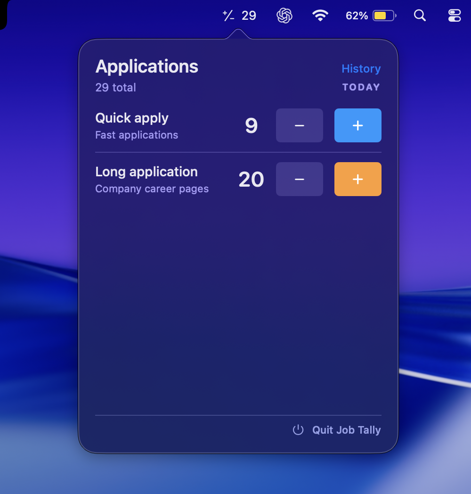
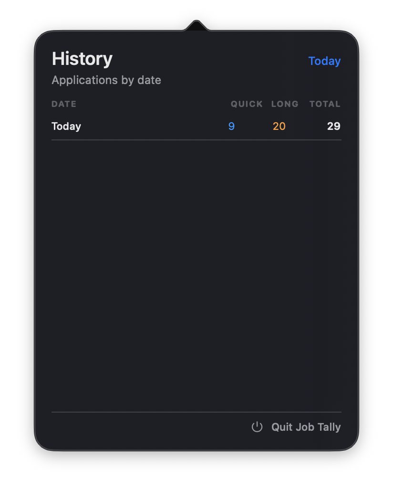

<picture>
  <source media="(prefers-color-scheme: dark)" srcset="assets/JobTally_logo.png">
  
</picture>

# Job Tally for macOS

A lightweight native menu bar app for counting job applications. Click the menu bar icon to open the counter, then use + or − for quick applies and longer applications through company career pages. Use **History** to see saved totals by date, or **Quit Job Tally** to close the app. Launching another copy focuses the one already running.

## Preview

<table>
  <tr>
    <th align="center">Daily counter</th>
    <th align="center">Application history</th>
  </tr>
  <tr>
    <td align="center"></td>
    <td align="center"></td>
  </tr>
</table>

## Daily history

Counts are saved locally on your Mac by date. The popover shows each saved day with separate quick and long totals. Starting a new day creates a new daily count while preserving previous days. Existing counts from the first version migrate automatically.

## Run it

Requires macOS 13 or later and Xcode Command Line Tools.

1. Clone or download this repository.
2. In Terminal, open the `JobTally` folder.
3. Run `./build.sh`.
4. Open the generated `Job Tally.app`.

The app runs in the menu bar and does not add a Dock icon. It is not signed or notarized for distribution; building it locally avoids needing to trust a downloaded app bundle.

## Make a GitHub download

The repository should contain the source files; attach the installable app to a GitHub Release. On a Mac, run `./package-dmg.sh` to create `dist/Job-Tally.dmg`, then upload that DMG under **Releases** on GitHub. The DMG is a convenient container for the app, but this unsigned build is intended for personal use or testing. For public distribution, sign with a Developer ID certificate and notarize it with Apple.
